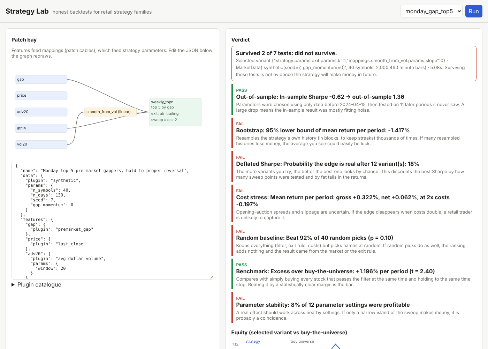

# Quant Open Source Programme: `honestbt`

An open, pluggable backtesting core whose main job is to **judge** retail
trading strategies honestly. Instead of one flattering equity curve, it runs a
whole *family* of variants and puts the best one through tests designed to
catch luck, overfitting, look-ahead and unrealistic costs.

> Surviving these tests means a result survived them. It is never evidence that
> a strategy will make money. Not financial advice.



## Quick start

```bash
pip install -e ".[web,dev]"
pytest -q                               # ~20 s
uvicorn honestbt.api:app --reload       # open http://127.0.0.1:8000, press Run
```

Or from Python:

```python
import json
from honestbt.runner import run_config
out = run_config(json.load(open("configs/monday_gap_top5.json")))
print(out["summary"])
for v in out["verdicts"]:
    print(v["passed"], v["name"], v["headline"])
```

## Architecture

```
            ┌──────────── patch bay (JSON config) ────────────┐
 data ──▶  features ──▶ mappings ("patch cables") ──▶ strategy ──▶ engine ──▶ evaluators ──▶ UI
 plugin    (vol, ATR,    (k = f(vol),                  (decide     (fills,     (OOS, bootstrap,
           gap, ...)      hold = f(ATR))                at time t)  costs)      deflated Sharpe ...)
                 ▲                                         ▲
                 └────── GuardedView pinned to time t ─────┘   ← look-ahead guard
```

Six plugin kinds, all registered with `@register(kind, name, params=[...])`
(see `honestbt/registry.py`). Third-party packages add plugins through the
`honestbt.plugins` entry-point group.

| Kind | Signature | Built-ins |
|---|---|---|
| `data` | `(**params) -> MarketData` | `synthetic`, `parquet` |
| `feature` | `(view, symbol, **p) -> float` | `premarket_gap`, `last_close`, `avg_dollar_volume`, `realized_vol`, `atr`, `atr_pct`, `trailing_return`, `random` |
| `mapping` | `(x, **p) -> float` | `identity`, `constant`, `linear`, `piecewise`, `step` |
| `signal` | `(path, ctx, **p) -> bool[]` | `atr_trailing`, `ema_cross`, `heikin_ashi`, `time_stop`, `any_of`, `never` |
| `strategy` | class: `decision_times`, `decide(view, resolver)` | `weekly_topn` |
| `evaluator` | `(ectx, **p) -> Verdict` | `out_of_sample`, `bootstrap`, `deflated_sharpe`, `cost_stress`, `random_baseline`, `benchmark`, `parameter_stability` |

### Honesty mechanisms built into the core

* **Look-ahead guard.** Strategy, feature and mapping code only ever see a
  `GuardedView` pinned to the decision time. A minute bar starting at `t` is
  visible from `t+1min`; a daily bar only after 16:00; asking for later data
  raises `LookAheadError`.
* **Causal exit signals.** Signals run on the position's minute path, and
  `check_causal` perturbs the future and checks the past output did not move.
  The engine runs it in strict mode; a peeking signal crashes the run.
* **Next-bar fills.** A signal at bar `i`'s close fills at bar `i+1`'s open.
  "Buy at the open, sell 5 minutes later" is `decision_time: 09:30` plus
  `time_stop(minutes=5)`, which buys the 09:30 open and sells the 09:35 open.
* **Survivorship.** Delisted names stay in the universe until they stop
  trading; open positions are marked out at the last price and flagged.
* **Costs.** Half-spread plus slippage on every fill, 3x wider in the first
  minutes after the open, never under half a cent per share.
* **Testing the testers.** The synthetic market has no edge by default; the
  test suite checks the evaluators reject it, and that they accept a planted
  edge (`gap_momentum > 0`).

### The patch bay

A config wires plugins together. Anywhere in strategy parameters you can write
`{"$map": "name"}` or `{"$feature": "name"}`; it's resolved per symbol at
decision time. `sweep` axes are dotted config paths, so you can sweep a
strategy parameter *or* a mapping's own parameters (i.e. a family of
functions). Example (`configs/monday_gap_top5.json`):

```json
"mappings": {"smooth_from_vol": {"plugin": "linear", "input": "vol20",
             "params": {"slope": 20, "intercept": 2, "lo": 3, "hi": 30}}},
"strategy": {"plugin": "weekly_topn", "params": {
    "top_n": 5, "rank_by": "gap", "min_price": 5, "min_dollar_volume": 5000000,
    "exit": {"plugin": "atr_trailing",
             "params": {"k": 1.0, "smooth": {"$map": "smooth_from_vol"}}}}},
"sweep": {"strategy.params.exit.params.k": [0.5, 1.0, 1.5, 2.0],
          "mappings.smooth_from_vol.params.slope": [0, 20, 40]}
```

## Guiding strategy: Monday top-5 gappers

Every week on the first trading day at 09:30, using only pre-market data:
filter to price ≥ $5 and 20-day dollar volume ≥ $5M, rank by pre-market gap,
buy the top 5 at the open (equal weight), and sell at the first "proper
reversal": the 10-minute-smoothed price falling `k × ATR(14)` below its peak,
with the smoothing span mapped from 20-day volatility. Anything still open
sells at the week's last close.

## Data

The `synthetic` plugin needs nothing. For real data, `scripts/download_polygon.py`
fills a local Parquet cache (`data/minute/<SYMBOL>.parquet`, split-adjusted,
with pre-market and delisted tickers) that the `parquet` plugin reads. Data
files are git-ignored. The downloader has not yet been run against a live key.

## Known limitations (v0.1)

* Positions within one decision period are equal-weighted and independent; no
  portfolio-level capital constraints or overlapping holdings across weeks.
* Trading calendar is inferred from the data, not an exchange calendar.
* Fills use minute-bar opens/closes; no order-book or auction modelling.
* Timestamps are naive US/Eastern.
