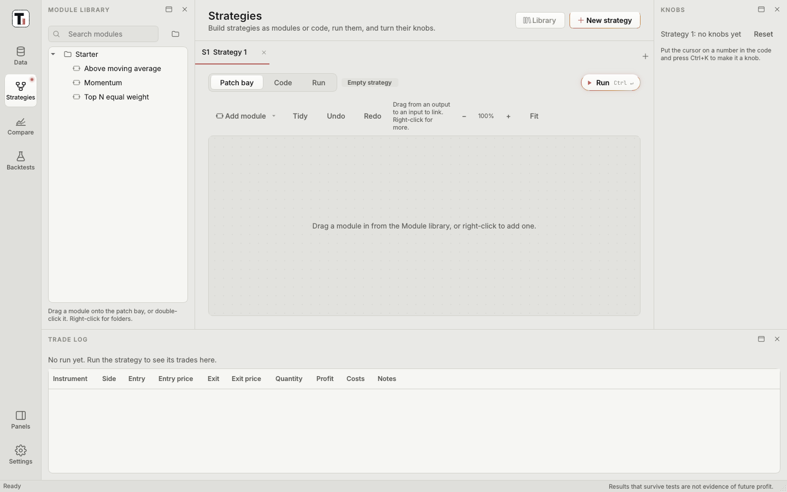

# Titanium

A desktop workbench for building, running and honestly judging trading strategies.

> This is the rebuild, from the framework upwards. The first prototype (the
> `honestbt` package and its app) is kept on the
> [`prototype-v0`](../../tree/prototype-v0) branch.



## Pages

| Page | Manages |
| --- | --- |
| Data | Datasets: where they come from, what they hold, where they are stored, who uses them. Core, complementary and generated data. |
| Strategies | One tab per strategy, each with three views: Patch bay, Code and Run. |
| Compare | Runs side by side, one tab per measurement. |
| Backtests | Tests that ask whether a result holds up. |
| Settings (corner) | Appearance, layout, libraries and plugins. |

Every panel is a view that can be shown as a page or as a dock (Settings → Layout,
or right-click a page in the rail).

## Download (Windows)

The latest build of `main` is on the
[desktop-latest release](../../releases/tag/desktop-latest):

- `TitaniumSetup.exe`: installer. Choose Standalone (includes its own Python) or Use my
  installed Python 3.11+.
- `Titanium.exe`: one portable file, no install.

Windows may warn about an unknown publisher: click More info, then Run anyway. Your
datasets, plugins, skins and module library live in `Documents/Titanium`.

## Run it

```bash
pip install -e ".[dev]"      # Python 3.11+
titanium                     # or: python -m titanium.desktop
python -m titanium.desktop.design.gallery   # every UI component, light (add --dark)
pytest -q
titanium --self-test         # opens every view and runs a small strategy, then exits
```

Build the Windows app yourself (on Windows): `pip install -e . pyinstaller`, then
`python packaging/build_exe.py` (portable exe) or `--onedir` plus Inno Setup's
`iscc packaging\installer.iss` (installer). `.github/workflows/desktop-build.yml` does
all of this on every push to `main` and on tags like `v0.2.0`.

## Layout

```
titanium/core/      no UI: markets, instruments, data, strategy model, engine,
                    measurements, backtests, plugins (interfaces for now)
titanium/app/       the shared objects every page works on
titanium/desktop/   the Qt shell: design system, views, pages and docks
tools/              screenshots of every page, light and dark
packaging/          the Windows build: PyInstaller entry, installer, icons
```

Not financial advice. Surviving tests is never evidence a strategy will make money.
