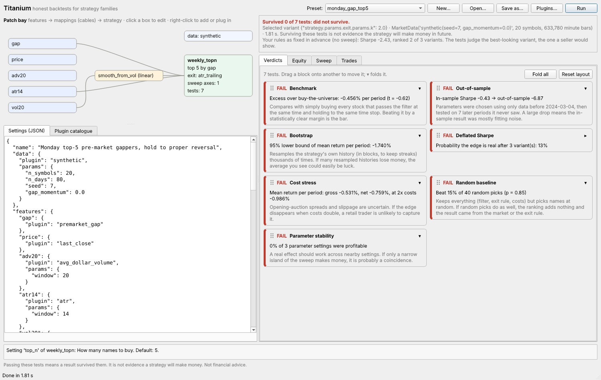
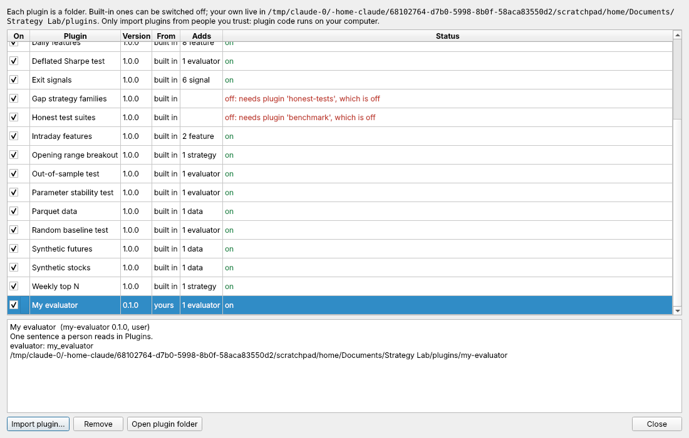
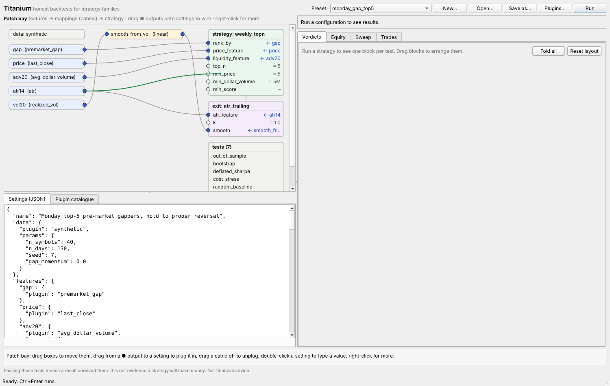

# Titanium

Titanium is the desktop app of the Quant Open Source Programme, built on the
`honestbt` package: an open, pluggable backtesting core whose main job is to **judge** retail
trading strategies honestly. Instead of one flattering equity curve, it runs a
whole *family* of variants and puts the best one through tests designed to
catch luck, overfitting, look-ahead and unrealistic costs.

> Surviving these tests means a result survived them. It is never evidence that
> a strategy will make money. Not financial advice.



## Quick start

**Windows:** from the
[desktop-latest release](https://github.com/eleadlau-commits/Quant_Open_Source_Programme/releases/tag/desktop-latest)
download `TitaniumSetup.exe` (installer: pick *Standalone* or *Use my
installed Python*) or `Titanium.exe` (portable single file, no install). It's unsigned, so Windows SmartScreen may warn: click
*More info → Run anyway*. Your own strategy files are saved in
`Documents/Titanium` (an old `Documents/Strategy Lab` folder is renamed
automatically the first time Titanium starts).

**From source (any OS).** Install Python 3.11+ from python.org, then
double-click `Titanium.bat` (Windows) or `Titanium.command` (Mac).
The first launch sets up a private environment in `.venv` (a few minutes);
after that it opens straight away. Or from a terminal:

```bash
pip install -e ".[desktop]"
titanium                                # or: python -m honestbt.desktop
```

**Developers / browser UI:**

```bash
pip install -e ".[web,dev]"
pytest -q                               # ~20 s
uvicorn honestbt.api:app --reload       # open http://127.0.0.1:8000, press Run
```

Or from Python:

```python
import json
from honestbt.runner import run_config
out = run_config(json.load(open("configs/monday_gap_top5.json")))
print(out["summary"])
for v in out["verdicts"]:
    print(v["passed"], v["name"], v["headline"])
```

## Architecture

```
            ┌──────────── patch bay (JSON config) ────────────┐
 data ──▶  features ──▶ mappings ("patch cables") ──▶ strategy ──▶ engine ──▶ evaluators ──▶ UI
 plugin    (vol, ATR,    (k = f(vol),                  (decide     (fills,     (OOS, bootstrap,
           gap, ...)      hold = f(ATR))                at time t)  costs)      deflated Sharpe ...)
                 ▲                                         ▲
                 └────── GuardedView pinned to time t ─────┘   ← look-ahead guard
```

Six plugin kinds, all registered with `@register(kind, name, params=[...])`.
Every plugin lives in its own folder (see [Plugins](#plugins) below), and the
built-in ones are in `honestbt/plugins/builtin/`.

| Kind | Signature | Built-ins |
|---|---|---|
| `data` | `(**params) -> MarketData` | `synthetic`, `synthetic_futures`, `parquet` |
| `feature` | `(view, symbol, **p) -> float` | `premarket_gap`, `last_close`, `avg_dollar_volume`, `realized_vol`, `atr`, `atr_pct`, `trailing_return`, `random`, `opening_range`, `htf_ema_spread` |
| `mapping` | `(x, **p) -> float` | `identity`, `constant`, `linear`, `piecewise`, `step` |
| `signal` | `(path, ctx, **p) -> bool[]` | `atr_trailing`, `ema_cross`, `heikin_ashi`, `time_stop`, `any_of`, `never` |
| `strategy` | class: `decision_times`, `decide(view, resolver)`, optional `poll_schedule` | `weekly_topn`, `opening_range_breakout` |
| `evaluator` | `(ectx, **p) -> Verdict` | `out_of_sample`, `bootstrap`, `deflated_sharpe`, `cost_stress`, `random_baseline`, `benchmark`, `parameter_stability`, `ablation` |

### Plugins

Each plugin is a folder, and any folder can be removed while the rest keep
working:

```
honestbt/plugins/builtin/bootstrap/
  plugin.json   {"id": "bootstrap", "name": "Bootstrap test", "version": "1.0.0", "api": 1,
                 "main": "plugin.py", "provides": {"evaluator": ["bootstrap"]}, "requires": []}
  plugin.py     the @register code; imports only honestbt.sdk, numpy, pandas and a little stdlib
  tests/        its own tests (pytest honestbt/plugins/builtin/bootstrap)
  README.md     What it adds / What it needs / Check it
  suites/       optional: named test suites, e.g. honest-stocks.json
  presets/      optional: settings files; a strategy family is a preset with a sweep
```

* **Independence.** A plugin whose `requires` are missing or off stays off
  and says why. A plugin whose code fails to load is switched off, and
  everything it registered is removed. A plugin may import only
  `honestbt.sdk` (the plugin API), so plugins never reach into each other.
  The tests remove every built-in folder in turn and check the rest load.
* **Your own plugins** go in `~/Documents/Titanium/plugins/<id>/` (or
  `$HONESTBT_PLUGIN_DIR`). They load the same way as the built-in ones.
* **Packs without code.** A folder with `"main": null` can ship only test
  suites (`"evaluators": [{"$suite": "honest-stocks"}]`) or only presets
  (strategy families). Examples: `honest-tests` and `gap-families`.
* This keeps plugins tidy and independent. It is **not** a sandbox: Python
  plugin code can do anything Python can, so only add plugins you trust.

**Sharing plugins as `.tiplug` files.** A `.tiplug` is one plugin folder
zipped into one file. In the desktop app, **Plugins… → Import plugin…** checks
it and adds it to your plugin folder. The window also lists every plugin with
the reason any of them is off, and lets you switch plugins on or off. The
same tools work from the command line:

```
python -m honestbt.plugins new my-test --kind evaluator   # also feature, strategy, signal, mapping, suite, preset
python -m honestbt.plugins check path/to/my-test          # manifest, imports, loads, suites, presets, its tests
python -m honestbt.plugins pack path/to/my-test           # -> my-test-0.1.0.tiplug
python -m honestbt.plugins install my-test-0.1.0.tiplug
python -m honestbt.plugins list
```



### Honesty mechanisms built into the core

* **Look-ahead guard.** Strategy, feature and mapping code only ever see a
  `GuardedView` pinned to the decision time. A minute bar starting at `t` is
  visible from `t+1min`; a daily bar only after 16:00; asking for later data
  raises `LookAheadError`.
* **Causal exit signals.** Signals run on the position's minute path, and
  `check_causal` perturbs the future and checks the past output did not move.
  The engine runs it in strict mode; a peeking signal crashes the run.
* **Next-bar fills.** A signal at bar `i`'s close fills at bar `i+1`'s open.
  "Buy at the open, sell 5 minutes later" is `decision_time: 09:30` plus
  `time_stop(minutes=5)`, which buys the 09:30 open and sells the 09:35 open.
* **Survivorship.** Delisted names stay in the universe until they stop
  trading; open positions are marked out at the last price and flagged.
* **Costs.** Half-spread plus slippage on every fill, 3x wider in the first
  minutes after the open, never under half a cent per share.
* **Testing the testers.** The synthetic market has no edge by default; the
  test suite checks the evaluators reject it, and that they accept a planted
  edge (`gap_momentum > 0`).

### The patch bay

A config wires plugins together. Anywhere in strategy parameters you can write
`{"$map": "name"}` or `{"$feature": "name"}`; it's resolved per symbol at
decision time. `sweep` axes are dotted config paths, so you can sweep a
strategy parameter *or* a mapping's own parameters (i.e. a family of
functions). Example (`configs/monday_gap_top5.json`):

```json
"mappings": {"smooth_from_vol": {"plugin": "linear", "input": "vol20",
             "params": {"slope": 20, "intercept": 2, "lo": 3, "hi": 30}}},
"strategy": {"plugin": "weekly_topn", "params": {
    "top_n": 5, "rank_by": "gap", "min_price": 5, "min_dollar_volume": 5000000,
    "exit": {"plugin": "atr_trailing",
             "params": {"k": 1.0, "smooth": {"$map": "smooth_from_vol"}}}}},
"sweep": {"strategy.params.exit.params.k": [0.5, 1.0, 1.5, 2.0],
          "mappings.smooth_from_vol.params.slope": [0, 20, 40]}
```



**Building in the desktop app.** The patch bay is a node editor over the
JSON, so you don't have to type it by hand (the JSON stays the source of
truth; every edit rewrites it, and Ctrl+Z in the editor undoes one):

* **New…** starts a strategy from a strategy plugin (a copy of the shipped
  example that uses it, so it runs straight away).
* **Boxes** are features (blue), mappings (yellow), the strategy (green), its
  exit (purple), the data source and the tests. Drag them anywhere; positions
  are saved in the file under `patchbay_layout`, which the backtest ignores.
* **Ports and cables.** Drag from a feature's or mapping's ● output onto a
  mapping's input or onto a strategy/exit setting:
  feature → mapping writes `"input": "gap"`, mapping → number setting writes
  `{"$map": "..."}`, feature → number setting writes `{"$feature": "..."}`,
  feature → ranking/feature setting writes its name. Wiring that makes no
  sense (a mapping into a ranking slot, a loop) is refused with a reason.
  Drag a cable off its input to unplug it (the setting goes back to its default).
* **Double-click** a setting to type a value; **right-click** it to unplug,
  edit, or *Sweep* it (adds a sweep axis around its value). Right-click
  empty space to add features, mappings, exits and tests; right-click a box
  to swap the strategy, exit or data, or remove it (or select it and press
  Delete). *Tidy layout* puts the boxes back in columns.
* Drag a plugin from the **Plugin catalogue** onto the patch bay (or
  double-click it) to add it.
* **Hover** over anything (a word in the settings, a patch-bay box, a button,
  a test) and the help line at the bottom of the window explains it.
* **Presets** are ready-made strategy files to start from: the examples in
  `configs/`, strategy families shipped in plugin packs (shown with the
  pack's name) and your own saved files (shown as "mine").
* In **Verdicts**, every test is its own block: drag blocks to arrange them
  and fold the ones you've read. The layout is remembered.

The patch bay recombines existing pieces. Genuinely new trading logic (a new
kind of entry rule) is a strategy plugin:
`python -m honestbt.plugins new my-rules --kind strategy`.

## Guiding strategy: Monday top-5 gappers

Every week on the first trading day at 09:30, using only pre-market data:
filter to price ≥ $5 and 20-day dollar volume ≥ $5M, rank by pre-market gap,
buy the top 5 at the open (equal weight), and sell at the first "proper
reversal": the 10-minute-smoothed price falling `k × ATR(14)` below its peak,
with the smoothing span mapped from 20-day volatility. Anything still open
sells at the week's last close.

## Second strategy: Nasdaq futures opening range breakout

`configs/nq_orb_trend_filter.json`. A strategy sold in a video, with its rules
written down **before** testing (each one is a patch-bay setting):

| Rule | Default |
|---|---|
| Box | high/low of 09:30-09:45 New York time (`box_start`, `box_end`) |
| Entry | first 5-minute candle (`signal_minutes`) that **closes** outside the box; enter at the next candle's open |
| 1R | box height from the fill (`stop_at: box_height`, `risk_r: 1`); or `opposite_edge` |
| Stop / target | 1R / 3R (`target_r`); stop is a market order when hit, target a resting limit |
| Exit otherwise | flat at 16:00 (`flat_time`) |
| Per day | one trade at most; no entries after 15:30 (`last_entry`, our addition: the video gives none) |
| Trend filter | longs only if 15-min (`trend_timeframe`) EMA50 > EMA200 (`ema_fast`, `ema_slow`), shorts only if below; a breakout the filter rejects means no trade that day (`filtered_breakout: skip_day`) |
| Contract, costs | 1 MNQ ($2/point, 0.25 tick) on a $10,000 account; $0.85 commission per side all-in; 1 tick slippage on entry, stop and flat-at-close; targets fill at their price |

How it fits the core:

* **Event-driven entries, still guarded.** A strategy can return a
  `poll_schedule`; the engine asks `decide` again at every 5-minute close
  with a `GuardedView` pinned to that instant, so the breakout candle must have
  closed before the strategy can see it. The trend EMAs drop the 15-minute
  candle still forming.
* **Shorts, brackets, futures P&L.** `Entry` takes `side`, a stop
  (`stop_price` or `stop_dist`) and `target_r`. Brackets are checked bar by
  bar; if one minute bar touches both stop and target we assume the stop
  (`stop_both_touched`), and a bar that opens through the stop fills at its open.
  With an `instrument` block, results are dollars per contract and each trade
  reports its R multiple.
* **Filtered vs unfiltered.** The `ablation` evaluator re-runs the chosen
  variant without the filter and tests the day-by-day difference. The random
  baseline keeps the same trade times and flips a coin for direction.
* **Hindsight.** The sweep varies box end (09:35/09:45/10:00), target
  (2/3/4R), filter timeframe (5/15/30 min) and EMA lengths (20 or 50 / 100 or
  200): 108 variants. The runner also reports where the rules as written
  (no sweep) rank among them.

What the synthetic data shows (`synthetic_futures` has no edge unless planted):

* Default seed, no edge: the best of the 108 variants (30-min EMA50/200,
  2R target) makes $15.7k on one MNQ over two years, beats the unfiltered
  version, passes out-of-sample, bootstrap, cost stress, random baseline and
  parameter stability, and only the deflated Sharpe (65%) catches it. The rules
  as written rank 27th of 108. Across 12 other seeds the fixed rules average
  about zero (filtered -$414, unfiltered +$701, ±$7-8k). That is how easily a
  "trend filter upgrade" appears from nothing once its settings are picked
  afterwards.
* Planted breakout edge (`orb_momentum: 1`): every test passes except the
  filter ablation, which correctly reports that the filter adds nothing:
  262 trades for $29.3k with it, 496 trades for $29.1k without. Half the trades
  and the same total, exactly the video's chart, from a filter that does nothing.
* Planted trend (`trend_strength: 0.5`): the ablation passes (t = 2.5).

### Real futures data

Futures need a different source from the equity downloader.
`scripts/download_databento.py` pulls CME Globex 1-minute bars (`GLBX.MDP3`,
`ohlcv-1m`) for the volume-rolled front month, back-adjusts each quarterly
roll using the second month, and writes `data/minute/MNQ.parquet`. It prints
the cost estimate first. Then point the config at it:

```json
"data": {"plugin": "parquet", "params": {"root": "data", "symbols": ["MNQ"]}}
```

It has not been run against a live key yet. Real data adds holidays and early
closes (exits then show as `delisted_or_halted`) and minutes without trades.
MNQ starts in May 2019; for longer history use NQ prices with `point_value: 2`.

## Data

The `synthetic` plugin needs nothing. For real data, `scripts/download_polygon.py`
fills a local Parquet cache (`data/minute/<SYMBOL>.parquet`, split-adjusted,
with pre-market and delisted tickers) that the `parquet` plugin reads. Data
files are git-ignored. The downloader has not yet been run against a live key.

## Known limitations (v0.1)

* Positions within one decision period are equal-weighted and independent; no
  portfolio-level capital constraints or overlapping holdings across weeks.
* Trading calendar is inferred from the data, not an exchange calendar.
* Fills use minute-bar opens/closes; no order-book or auction modelling.
  Futures targets fill when touched, which flatters limit orders slightly
  (raise `target_slippage_ticks`, or stress costs, to be stricter).
* Timestamps are naive US/Eastern.
