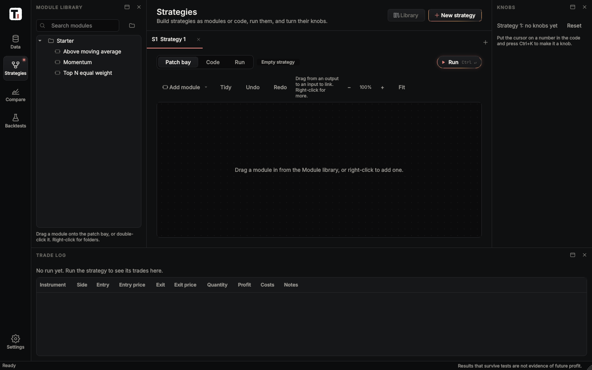
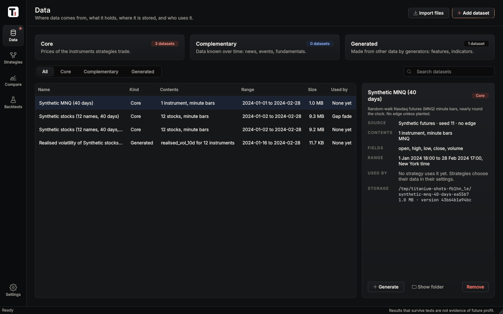
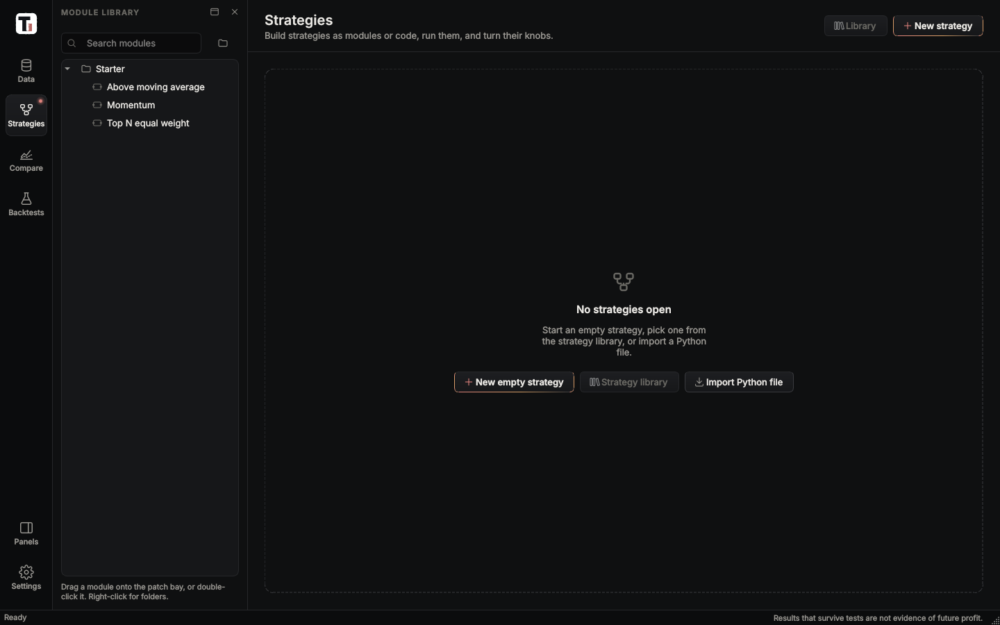
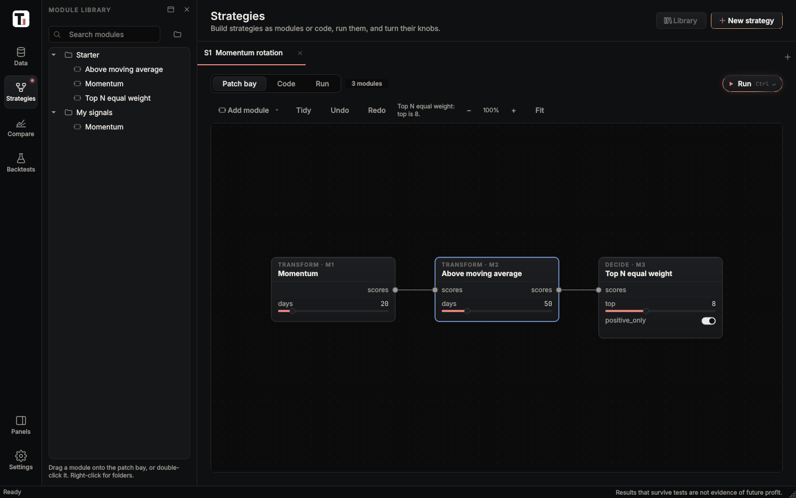
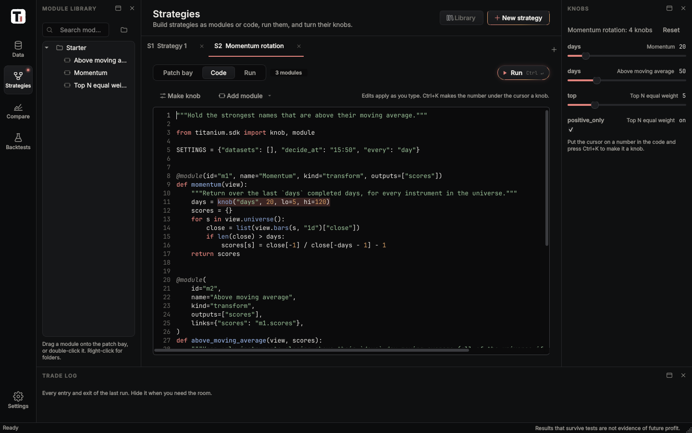
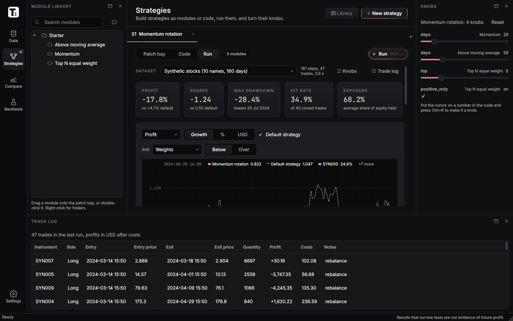
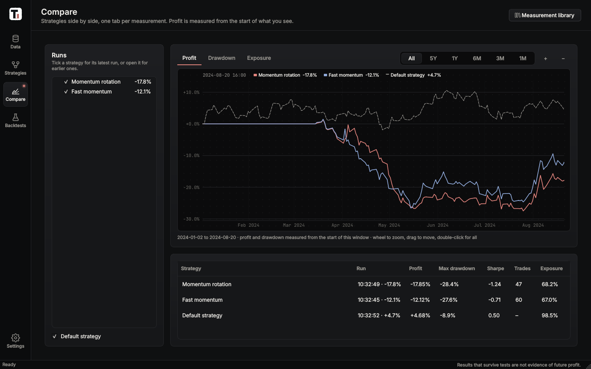
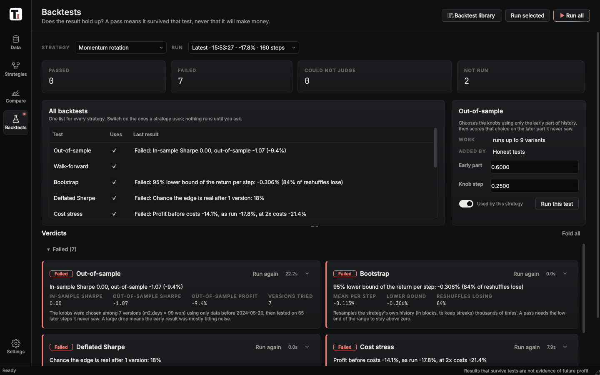
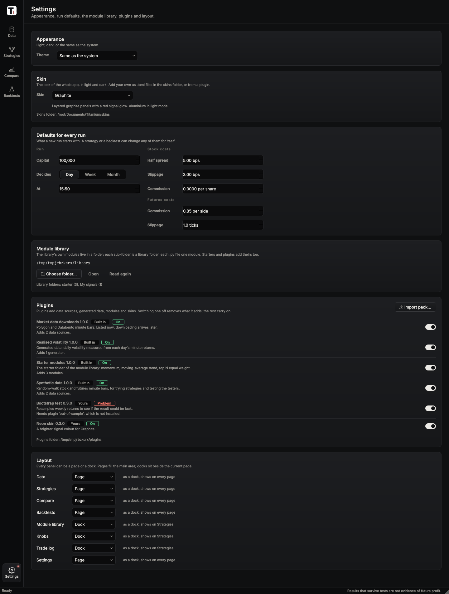

# Titanium user manual

Titanium is a desktop workbench for building trading strategies, running them on historical
data, and testing whether the results hold up. This manual goes page by page: find the page
you are looking at and read its section.

Not financial advice. A strategy that passes every test can still lose money.

**Contents**

1. [Install and first launch](#1-install-and-first-launch)
2. [Getting around](#2-getting-around)
3. [Data](#3-data)
4. [Strategies: tabs](#4-strategies-tabs)
5. [Strategies: Patch bay](#5-strategies-patch-bay)
6. [Strategies: Code](#6-strategies-code)
7. [Strategies: Run](#7-strategies-run)
8. [Compare](#8-compare)
9. [Backtests](#9-backtests)
10. [Settings](#10-settings)
11. [Troubleshooting](#11-troubleshooting)
12. [Glossary](#12-glossary)

---

## 1. Install and first launch

### Download

The newest build is always on the
[desktop-latest release](https://github.com/eleadlau-commits/Quant_Open_Source_Programme/releases/tag/desktop-latest).
It is rebuilt every time `main` changes. It has two files:

| File | What it is |
| --- | --- |
| `TitaniumSetup.exe` | The installer. Adds a Start menu entry and, if you want, a desktop shortcut. |
| `Titanium.exe` | One portable file. Nothing to install: double-click it to run. |

The installer asks for one of two setups:

- **Standalone** includes its own Python. It's a bigger download, but nothing else is needed.
- **Use my installed Python 3.11+** is smaller. It uses the Python you already have and sets up a
  private environment for Titanium.

### Windows warnings

The builds are not code-signed yet, so Windows may stop them.

- **"Windows protected your PC"** (SmartScreen): click **More info**, then **Run anyway**.
- **Smart App Control** blocks unsigned apps outright and offers no Run anyway button. If it
  is on, run Titanium from Python instead:
  1. Install Python 3.11 or newer from [python.org](https://www.python.org/downloads/).
  2. Open a terminal and run
     `py -m pip install https://github.com/eleadlau-commits/Quant_Open_Source_Programme/archive/refs/heads/main.zip`
  3. Start the app with `pyw -m titanium.desktop`. Run the same command again any time you
     want to open it, and repeat step 2 to update.

### Where your files live

Everything you make is kept in `Documents\Titanium`:

| Folder | Holds |
| --- | --- |
| `data` | Your datasets |
| `library` | Your module library folders (you can choose another folder in Settings) |
| `plugins` | Plugins you add |
| `skins` | Skins you add |

Strategies are saved wherever you save them, as `.json` files.

### First launch

On the very first launch Titanium adds two **sample datasets** in the background, so you have
something to try straight away:

- Sample stocks: 20 made-up Nasdaq names, 60 days of minute bars.
- Sample futures: a made-up MNQ contract on CME, 60 days.

They are random walks with no real edge. Remove them from the Data page when you have your
own data.

---

## 2. Getting around



The **rail** on the left switches pages: Data, Strategies, Compare and Backtests. Settings
sits at the bottom corner.

- **Pages and docks.** Every panel can be a page (it fills the main area) or a dock (it sits
  beside whatever page is showing). To make a page into a dock, right-click it in the rail and
  choose **Show as a dock**. A dock's title bar has buttons to turn it back into a page or hide
  it. The **Panels** button in the rail shows or hides each dock.
- **The Run button** is the one control that glows. It runs the strategy in front, and pressing
  it again while it runs cancels. Ctrl+Enter does the same.
- **Busy means busy.** While something long runs, the part of the window it affects is
  covered and shows its progress. Everything outside that part keeps working as normal.
- **Light and dark.** Settings → Appearance chooses light, dark, or the same as Windows.

### Quick start

1. Open **Strategies**. The **Default** tab is already there.
2. Pick a dataset from **Dataset** at the top of the Run view (a sample one is fine).
3. Press **Run**. The chart shows the strategy's profit, and the tiles show its numbers.
4. Turn a knob in the **Knobs** panel. The strategy runs again on its own.
5. Press **All tests** to open Backtests, and press **Run all** to see whether the result holds up.

---

## 3. Data



The Data page lists every dataset: where its data comes from, what it holds, where it is
stored and which strategies use it.

### Kinds of data

| Kind | What it is |
| --- | --- |
| Core | Prices of the instruments strategies trade (minute or daily bars). |
| Complementary | Data known over time: news, events, fundamentals. |
| Generated | Made from other data by generators: features and indicators. |

### The table

| Column | Shows |
| --- | --- |
| Name | The dataset's name |
| Kind | Core, complementary or generated |
| Market | The market it follows, such as Nasdaq or CME |
| Contents | Its instruments or fields |
| Range | First and last dates |
| Size | Space on disk |
| Used by | The strategies that trade it |

Use the search box to find a dataset by name, and the market filter to show one market.

### Adding data

- **Add dataset** makes a dataset from a data source. Pick a source, fill in its settings, and
  press **Add dataset** at the bottom of the window. The sources that come with the app:
  - **Synthetic stocks** and **Synthetic futures**: random-walk minute bars for trying things
    and testing the tests.
  - **Polygon** and **Databento**: listed as "coming later". Downloading isn't there yet.
- **Import files** copies CSV or Parquet files from your computer into the data folder.
  - Use one file per instrument, named after it (for example `AAPL.csv`), or pick a whole folder.
  - Price files need `open`, `high`, `low` and `close` columns. `volume` is optional.
  - The time column can be called `timestamp`, `time`, `datetime`, `date`, `ts`, `start` or
    `known`. Times with no time zone are read in the market's local time.
  - Choose **core** for price bars or **complementary** for values known over time. A
    complementary value with only a date counts as known at that day's close, so it can't
    leak into the same day's decisions.
- **Remove samples** removes the sample datasets that no strategy uses.

### The details panel

Select a dataset to see its source, what it holds, which strategies use it, and where it is
stored (with its size and version).

- **Generate** makes generated data from this dataset, such as daily realised volatility. Each
  value is stamped with the time it could first be worked out, so strategies never see it early.
- **Show folder** opens the folder where its files are stored.
- **Market settings** opens that market's sessions, holidays and defaults in Settings.
- **Remove** deletes the dataset and its files. You can't remove a dataset while a
  strategy uses it: pick another dataset for that strategy first.

---

## 4. Strategies: tabs



The Strategies page has one tab per open strategy. Each tab has three views, switched at the
top: **Patch bay**, **Code** and **Run**. Patch bay and Code are two editors of the same
strategy, so a change in one shows up in the other straight away.

### Adding a strategy

Press **New strategy** in the page header and pick one:

- **New empty strategy**.
- **Import a Python file…** turns a `.py` strategy into a new tab and opens it on its code.
- **Open a strategy file…** opens a saved `.json` strategy.
- **From the strategy library…** is greyed out for now. It comes in a later version.

A new strategy is called "Strategy N" until you rename it.

### The Default tab

The **Default** tab is always open, always first, and can't be closed or deleted. It holds the
default strategy: equal weight in everything in the dataset, put back to equal each month.

You can run it, turn its knobs and change its run settings, but you can't change its modules
or code. Press **Duplicate to edit** to get an editable copy in a new tab.

### The tab menu

Right-click a tab for:

| Action | What it does |
| --- | --- |
| Save (Ctrl+S) | Saves the strategy to its `.json` file |
| Rename… | Changes the name shown on the tab |
| Duplicate | Opens a copy as a new strategy, with its own runs |
| Close | Same as the tab's ✕ |
| Delete… | Removes the strategy for good |

**Close** only closes the tab. If there are unsaved changes, it asks whether to save first.
The strategy's runs stay until you quit, and come back if you open its file again.

**Delete** can't be undone. It stops any runs or tests of the strategy that are still going,
and removes its runs and their backtest results. Its saved file is deleted only if you tick
**Also delete the saved file**.

---

## 5. Strategies: Patch bay



The patch bay draws a strategy as **modules** on a canvas, linked by **cables**. Data flows
left to right, ending in a decide module that sets what to hold.

### Modules and cables

- A module shows its **inputs** on the left, its **outputs** on the right and its **knobs**
  below. Drag a slider or click a switch to turn a knob.
- **To link two modules**, drag from an output port and drop it on an input. Anywhere on the
  input's row works.
- **To move or unplug a cable**, drag its end off the input.
- Some links are refused, and the app says why: the input is already taken, the link would
  make a loop, or a module would feed itself.
- **Double-click a module's title** to jump to its code in the Code view.

### Right-click menus

| On | You can |
| --- | --- |
| Empty canvas | Add a module here, Tidy layout, Fit to view, Select all |
| A module | Rename, Show code, Unplug, Duplicate, Save to module library, Remove |
| A cable | Unplug it |

### Keys and mouse

| Key or mouse | Does |
| --- | --- |
| Delete or Backspace | Remove the selection |
| Ctrl+Z / Ctrl+Shift+Z | Undo / redo a change made on the canvas |
| Ctrl+D | Duplicate the selection |
| Ctrl+A | Select all |
| Ctrl+0 | Fit everything in view |
| Ctrl+= / Ctrl+− | Zoom in / out |
| Mouse wheel | Zoom at the cursor |
| Middle-drag, or Space and drag | Pan |
| Drag on empty canvas | Select a group |

### The Module library

The **Module library** panel lists modules you can add, in folders:

- **Starter**: the app's own modules (Momentum, Above moving average, Top N equal weight).
- **Your folders**: modules you saved. Each is a `.py` file in your library folder.
- **Plugin folders**: modules added by plugins.

Drag a module onto the canvas, or double-click it, to add it to the strategy in front. Use the
search box to filter by name or description.

Right-click in the library to make, rename or delete your folders, and to rename, move or
delete your modules. You can also drag a module onto one of your folders to move it there.
Starter and plugin modules can't be changed, only copied into your folders. To keep your own
version of a module from the canvas, right-click it and choose **Save to module library**.

Deleting a module from the library doesn't change strategies that already use it: each one
keeps its own copy.

---

## 6. Strategies: Code



The Code view shows the same strategy as one Python file. Edits apply as you type, and the
patch bay redraws to match. If the code can't be read, the view says which line is wrong and
nothing else changes.

```python
from titanium.sdk import knob, module

SETTINGS = {"decide_at": "15:50", "every": "day"}


@module(id="m1", name="Momentum", kind="transform", outputs=["scores"])
def momentum(view):
    days = knob("days", 20, lo=5, hi=120)
    ...
    return scores


@module(id="m3", name="Top N equal weight", kind="decide", links={"scores": "m1.scores"})
def top_n_equal_weight(scores):
    top = knob("top", 5, lo=1, hi=20)
    ...
    return {s: 1 / len(best) for s in best}
```

- **Each function is one module.** Its parameters are its inputs. `view` (the data up to the
  decision time) and `portfolio` are given to every module and aren't inputs.
- **Links** are written on the module that receives them:
  `links={"input": "module_id.output"}`.
- **Knobs** are `knob("name", default, lo=, hi=)`. A whole-number default makes a whole-number
  knob, a decimal makes a real knob, and `True` or `False` makes a switch.
- **Make knob**: put the cursor on a number and press **Ctrl+K**. The number becomes a knob you
  can turn in the Knobs panel, and the code and the patch bay stay in sync both ways.
- **The decide module** returns target weights, such as `{"AAPL": 0.5, "MSFT": 0.5}`, or a list
  of orders.
- **Add module** in the header inserts a module from the module library.
- Code above the modules (imports, helpers, constants) is kept as it is, and every module can
  use it.

A plain Python file with a `decide(F, p)` function, as written for the first prototype,
imports as a one-module strategy.

---

## 7. Strategies: Run



The Run view runs the strategy and shows how it did against the default strategy.

### Running

1. Pick the **Dataset** the strategy trades at the top. The line beside it says the market,
   its trading hours and when the strategy decides.
2. Press **Run** or Ctrl+Enter. The code is read back first, so your latest edits are included.
   Press Run again to cancel.
3. When it's done, the line under the chart says how many steps and trades the run took and how
   long it ran.

If you change something after a run, the view says "Settings changed. Run again" so you know
the chart is out of date.

### Tiles

Profit, Sharpe, Max drawdown, Hit rate and Exposure, each shown against the default strategy.

### The chart

- **Measurement** picker: what the main line shows (profit, drawdown or exposure).
- **Growth / % / USD**: profit as growth of 1, in percent, or in money.
- **Default strategy** switch: draws the yardstick as a dashed line.
- Green dots are entries, red dots exits.
- A second picker adds a per-instrument measurement (positions, weights, cash, module outputs).
  Choose **Below** to draw it in its own panel, or **Over** to draw it on top on its own scale.
- Wheel zooms in time, drag moves, and double-click shows the whole run.
- **Drag the bottom edge** of the chart to resize it. The height is remembered for every tab.

### Knobs

The **Knobs** panel lists every knob in the strategy. Turn one and the strategy runs again
straight away. **Reset** puts every knob back to its default.

### Trade log

The **Trade log** lists the trades of the last run: instrument, side, quantity, entry and exit
prices, profit, costs and notes. **Pop out** moves it (or the Knobs panel) into its own dock,
which follows whichever strategy tab is in front.

### Run settings

**Run settings** opens a panel with every setting the next run will use and where each value
comes from:

| Setting | What it is |
| --- | --- |
| Capital | Notional starting cash, in the market's currency. Results are shown normalised. |
| Decides | Every trading day, or the first day of each week or month |
| Decides at | The time of day the strategy decides, in the market's local time |
| Trade outside the regular session too | Off trades regular hours only; on trades every session |
| Exposure cap | The most the strategy may hold in total, as a share of equity |
| Smallest trade | Trades smaller than this share of equity are skipped, so tiny rebalances don't pay costs |
| Stock half spread, slippage, commission | Costs for stocks, in basis points |
| Futures commission, slippage | Costs for futures, per contract |

Each value comes from one of four layers, and each layer overrides the one before:

1. The app's defaults (Settings → Defaults for every run).
2. The market's defaults (Settings → Markets).
3. This strategy's own value, set here. **Use default** drops it again.
4. A backtest's change, for that test only.

### The backtest block

Under the chart, four quick tests run on the last run: Out-of-sample, Cost stress, Random
baseline and Walk-forward. Their verdicts show here as they arrive. While they run, only this
block is covered, and the rest of the view stays usable. **All tests** opens the Backtests
page.

---

## 8. Compare



Compare puts runs side by side, with one tab per measurement (Profit, Drawdown, Exposure).

- **Tick a strategy** to show its latest run. Open it to tick earlier runs too.
- The **default strategy** is drawn dashed. It's the yardstick each run is measured against,
  run on the same terms (dataset, dates, capital, costs). Any that are missing are run in the
  background.
- **Profit and drawdown are measured from the start of what you see.** Zoom in on a stretch of
  time and the lines and the table below are measured over that stretch.
- The table lists each run's profit, Sharpe, max drawdown, exposure and trades.
- **Measurement library** lists every measurement in the app, what it shows and where it
  comes from.

Runs last until you quit the app.

---

## 9. Backtests



A backtest asks whether a result holds up. **A pass means only that the result survived that
test, never that the strategy will make money.**

### Running tests

1. Pick a **strategy** and one of its **runs**. The latest run is picked by default.
2. Then do one of these:
   - **Run all** runs every test the strategy uses, one after another.
   - **Run selected** runs the tests selected in the list. Ctrl-click or Shift-click to
     select more than one.
   - Double-click a test to run just that one.
3. **Stop** cancels.

The **Uses** switch beside each test says whether Run all includes it. The panel beside the
list holds the selected test's settings. Both are saved with the strategy.

If the strategy has changed since the run, the page says so. Run it again on the Strategies
page to test the new version.

### Verdicts

Verdicts arrive one by one, grouped into **Failed**, **Passed** and **Could not judge**. Each one
gives a headline in plain words, why it matters, and the figures behind it. **Fold all** folds
every verdict down to its headline.

### The tests

| Test | What it checks | Extra runs |
| --- | --- | --- |
| Out-of-sample | Chooses the knobs on the early part, scores the later part it never saw | Up to 9 |
| Walk-forward | Re-chooses the knobs before each stretch, scores only what follows | Shared with out-of-sample |
| Bootstrap | Reshuffles the returns in blocks: the low end must stay above zero | None |
| Deflated Sharpe | Discounts the Sharpe ratio for versions tried this session and for fat tails | None |
| Cost stress | Runs with costs off and with costs multiplied: must still make money | 2 |
| Random baseline | Same timing, weights and holding periods, with names picked at random | Several |
| Benchmark | Step by step against the default strategy, on the same costs | 1 |
| Parameter stability | Share of nearby knob settings that still make money | Shared |
| Ablation | Takes out a filter module or switch knob: does it earn clearly more with it? | 1 |

**Backtest library** lists every test and where it comes from. Plugins can add more.

---

## 10. Settings



Settings opens from the bottom corner of the rail.

| Card | What it sets |
| --- | --- |
| Appearance | Theme: light, dark, or the same as the system |
| Skin | The look of the whole app. Graphite is the default and Classic is the original. Add your own as `.toml` files in the skins folder, or from a plugin. |
| Defaults for every run | Capital, how often strategies decide, exposure cap and smallest trade. Every new run starts with these. |
| Markets | One market at a time: its sessions and holidays (**Holidays in …** lists the days without trading), and its defaults: decision time, whether to trade outside the regular session, and costs. **Use the market's own** goes back to what the market comes with. |
| Module library | The folder your module library lives in. **Choose folder…** changes it, **Open** shows it, and **Read again** picks up files you changed outside the app. |
| Plugins | Every plugin, on or off and why, with a switch for each. **Import pack…** adds a `.tiplug` plugin pack. Switching a plugin off removes what it adds; everything else carries on. |
| Layout | Whether each panel is a page or a dock |

Plugins that come with the app: Synthetic data, Market data downloads, Realised volatility,
Starter modules and Honest tests (the backtests). Only add plugins from people you trust.

---

## 11. Troubleshooting

**Windows won't open the app.** See [Windows warnings](#windows-warnings). With Smart App
Control on, run it from Python.

**Run says "Pick a dataset for this strategy first".** Choose one from **Dataset** at the top of
the Run view. If the list is empty, add one on the Data page.

**A dataset can't be removed.** A strategy still uses it. Pick another dataset for that
strategy, then remove it.

**My runs are gone after a restart.** Runs and backtest results last for the session only.
Strategies, datasets, module library folders and settings are kept.

**A backtest says "Could not judge".** The test couldn't reach a verdict on this run. Open the
verdict to see why.

---

## 12. Glossary

| Term | Meaning |
| --- | --- |
| Strategy | A set of linked modules that decides what to hold |
| Module | One step of a strategy: a Python function with inputs, outputs and knobs |
| Knob | A setting of a module you can turn without editing code |
| Decide module | The last module, which returns what to hold |
| Run | One pass of a strategy over a dataset, giving trades and results |
| Decision time | The time of day a strategy decides. It only sees data known by then. |
| Default strategy | Equal weight in everything in the dataset, rebalanced monthly: the yardstick |
| Measurement | A number or curve read from a run, such as profit or drawdown |
| Backtest | A test of whether a run's result holds up |
| Dock | A panel shown beside the current page instead of as a page |
| Skin | A look for the whole app, in light and dark |
| Plugin | A folder that adds data sources, modules, skins, measurements or tests |

---

For how Titanium works inside (the engine, plugins, the design language), see the notes in
this folder: [engine](engine.md), [plugins](plugins.md), [backtests](backtests.md),
[measurements](measurements.md), [strategies](strategies.md), [patch bay](patch-bay.md),
[strategy code](strategy-code.md) and [design language](design-language.md).
